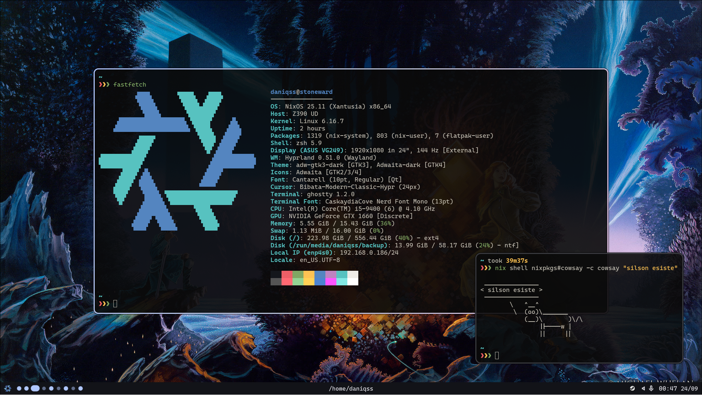

# daniqss/nixcfg

  
  
  

<br>



## how to install
this is basically a little guide to remember the next time I add a host or reinstall nixos in a machine
1. install nixos (non-desktop option) with the graphical installer
2. boot to the new system
3. run `nix shell nixpkgs#git --extra-experimental-features nix-command --extra-experimental-features flakes`
4. clone the repo and,
  - if ur adding a new host
    1. set up wifi with `nmtui` if ur on a laptop
    2. add the new host in `~/nixcfg/hosts/default.nix`
    3. create a new folder called after the new host's name in `~/nixcfg/hosts` with the required files and options
5. run `sudo nixos-rebuild boot --flake ~/nixcfg/#<HOSTNAME>` and `reboot`
6. if it's a server (`server.enable = true`), follow [new server](#new-server)
7. enjoy

### raspberry pi 5
to build the rpi5 image u shoud follow [the nixos wiki](https://wiki.nixos.org/wiki/NixOS_on_ARM/Raspberry_Pi_5). Furthermore, I follow [this template flake](https://github.com/thtrf/nixos-rpi-5) for the installation and for taking inspiration from the flake config

## homelab
the servers expose their services through caddy at `<service>.<host>.tailb76493.ts.net`, only reachable from the tailnet

| url                                         | service |
|---------------------------------------------|---------|
| `https://photos.bondsmith.tailb76493.ts.net` | immich  |
| `https://git.bondsmith.tailb76493.ts.net`    | forgejo, ssh as `git@git.bondsmith.tailb76493.ts.net:<owner>/<repo>` |
| `https://bondsmith.tailb76493.ts.net`        | immich, for the phone app |

tailscale doesn't resolve nor issue certs for subdomains of a machine yet ([#1196](https://github.com/tailscale/tailscale/issues/1196), [#7081](https://github.com/tailscale/tailscale/issues/7081)), so meanwhile
- caddy signs the subdomains with its internal ca, whose root cert is copied to `hosts/<host>/caddy-root.crt`
- `lib/homelab.nix` collects the servers, and every nixos host with tailscale gets the subdomains in `/etc/hosts` and trusts their cas, also in the chrome nss db through home manager
- the phone can't do any of that, so the immich app uses the bare machine name with the real tailscale cert


### new server
1. if it runs caddy, set `server.caddy.address` to its `tailscale ip -4`
2. switch it, caddy creates its root ca on the first start
3. copy the root cert to the repo and track it, flakes ignore untracked files
   ```sh
   sudo cat /var/lib/caddy/.local/share/caddy/pki/authorities/local/root.crt > hosts/<host>/caddy-root.crt
   git add hosts/<host>/caddy-root.crt
   ```
4. switch every host, the server included, so they trust it
5. if it runs forgejo, create the admin with `forgejo-admin user create --admin --username <user> --email <email> --random-password`

## content
This configuration fits my needs and I intend to update it as I need it. My objective with this config is to store in this repo all my hosts configurations plus some packages that are not in nixpkgs and templates for all my programming use cases

### hosts
hosts are named thematically after the stormlight archive radiant orders according to their use

| Host           | Description                                         | Arch          |
|----------------|-----------------------------------------------------|---------------|
| **stoneward**  | Intel + NVIDIA desktop, for programming and gaming  | x86_64-linux  |
| **windrunner** | AMD uni laptop                                      | x86_64-linux  |
| **bondsmith**  | Raspberry Pi 5 home server                          | aarch64-linux |
| **skybreaker** | Slimbook with core 5 120U                           | x86_64-linux  |

### rice
I'm currently using the [hyprland](https://hypr.land) wayland compositor using my own bar made with [quickshell](https://quickshell.org/) that I want to upgrade until it satisfies all my desktop shell necesities.
I use [matugen](https://github.com/InioX/matugen) to generate from the current selected wallpaper the colors schemes used in most of the software I use (not the terminal nor vscode)

## Todo
- [ ] dendrite pattern
- [ ] build + commit scripts with just or nu

## special thanks to
Thanks to these people from whom I learned ~~and sometimes stole~~ nix and quickshell, and I got inspiration for desktop shell designs

- [raexera](https://github.com/raexera/yuki),
- [fufexan](https://github.com/fufexan/dotfiles),
- [redyf](https://github.com/redyf/nixdots),
- [NotAShelf](https://github.com/NotAShelf/nyx),
- [outfoxxed](https://git.outfoxxed.me/outfoxxed/nixnew),
- [isabelroses](https://github.com/isabelroses/dotfiles),
- [thtrf](https://github.com/thtrf/nixos-rpi-5)

